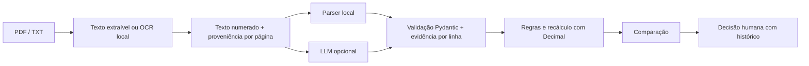
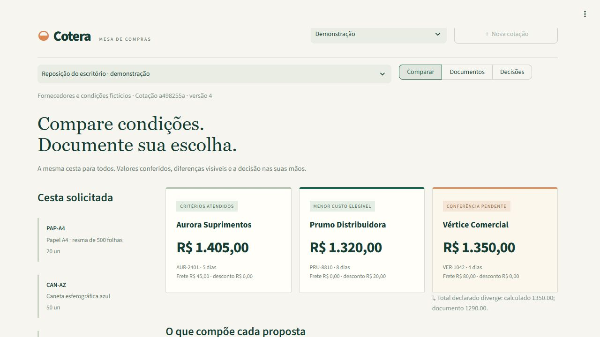
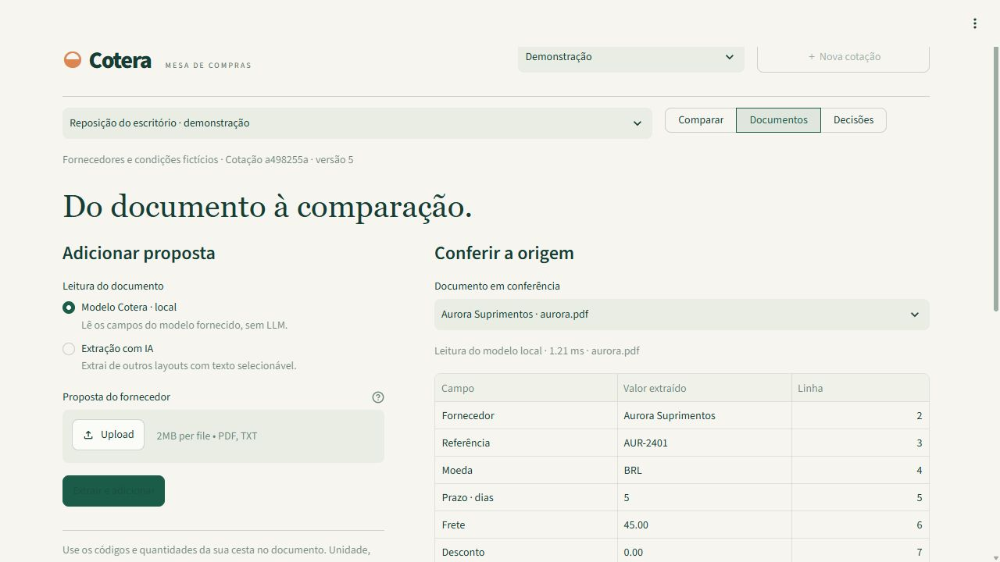
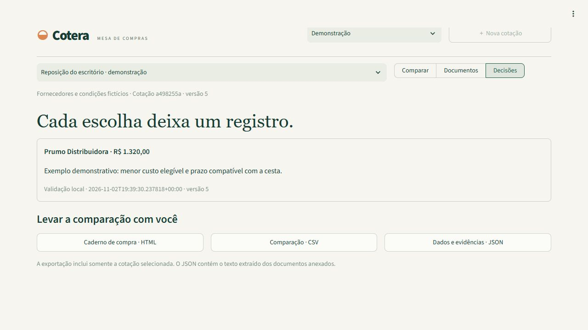

# ◒ Cotera

**Cotações comparáveis. Decisões que deixam rastro.**

🔗 **Demo online:** [cotera.streamlit.app](https://cotera.streamlit.app/) (modo local, sem chave de API; clique em "Carregar exemplo")

Receba propostas de fornecedores em PDF, transforme os documentos em dados e compare a mesma cesta de produtos. O Cotera confere quantidades, unidades, frete, desconto, prazo e total antes de liberar o registro da escolha.

## Como funciona



## Destaques técnicos

- Parser local como padrão: demonstração e conferências funcionam sem chave de API.
- OCR local gratuito com Tesseract (`por+eng`) para páginas escaneadas, com confiança por página e revisão humana obrigatória.
- LLM opcional, exibido somente com `OPENAI_API_KEY` no ambiente ou em `st.secrets`, com autorização antes de enviar o texto.
- Contratos Pydantic e conferência literal dos valores nas linhas citadas, com o texto disponível para revisão.
- Recálculo com `Decimal` e `ROUND_HALF_UP`; propostas com pendências ficam fora da escolha e do menor custo elegível.
- Deduplicação pelo hash do arquivo, transações e decisões vinculadas à versão da cotação, preservando o histórico.
- SQLite com fallback para diretório temporário e adaptador PostgreSQL; exportação em HTML, CSV e JSON.
- API FastAPI, workflow n8n importável e CI com Python 3.12 e 3.14 e serviço PostgreSQL.

A qualidade da extração com LLM ainda não foi medida com um modelo real. As avaliações publicadas executam somente a baseline local, sem chamadas de API. Há um dataset variado de 36 propostas fictícias e dois casos OCR complementares; os testes de métricas usam cliente simulado. Os relatórios distinguem essas situações.

## Interface



| Documentos e evidências | Decisão e histórico |
|---|---|
|  |  |

**Stack:** Python 3.12+ · Streamlit · Pydantic · pypdf · pypdfium2 · Pillow · Tesseract / pytesseract · Decimal · SQLite / PostgreSQL (psycopg) · FastAPI / Uvicorn · SDK OpenAI opcional · pytest · Docker Compose · n8n.

[Estudo de caso](docs/ESTUDO_DE_CASO.md) · [Arquitetura](docs/ARQUITETURA.md) · [Automação com n8n](docs/AUTOMACAO.md) · [Avaliação reproduzível](reports/evaluation.json)

## Uma compra, três momentos

1. **Comparar:** veja a cesta, as propostas, os preços unitários e as pendências. O menor custo é destacado apenas entre propostas elegíveis.
2. **Documentos:** adicione PDF/TXT e confira cada campo com a linha de origem.
3. **Decisões:** consulte quem registrou a escolha, a justificativa e a versão comparada. Exporte HTML, CSV ou JSON.

Em **Minhas cotações**, crie uma cesta própria com códigos, descrições, quantidades, unidades e prazo máximo opcional. Cada cotação aceita até dez propostas. A demonstração usa um banco separado.

O registro da escolha não envia pedidos, contrata fornecedores nem realiza pagamentos. Uma nova escolha acrescenta um evento; o histórico anterior é preservado.

## Demonstração verificável

A cesta contém vinte resmas de papel, cinquenta canetas e dez organizadores. Todos os fornecedores, referências e condições são fictícios.

| Fornecedor | Total calculado | Prazo declarado | Conferência |
|---|---:|---:|---|
| Aurora Suprimentos | R$ 1.405,00 | 5 dias | Elegível |
| Prumo Distribuidora | R$ 1.320,00 | 8 dias | Menor custo elegível |
| Vértice Comercial | R$ 1.350,00 | 4 dias | Pendente: o documento declara R$ 1.290,00 |

A diferença entre Aurora e Prumo é uma comparação de valores fictícios, não uma economia obtida por uma empresa. A escolha considera a justificativa da pessoa responsável; menor custo não é sinônimo de melhor fornecedor em todos os critérios.

Os exemplos estão em [data/proposals](data/proposals). O [gerador dos documentos](scripts/create_samples.py) reproduz os PDFs e TXTs a partir de valores explícitos.

O botão **Carregar exemplo escaneado** abre uma cesta demonstrativa própria, com a Aurora só-imagem no lugar da versão textual e as outras duas propostas. A confirmação informa o carregamento e aponta para **Comparar**. Os dois botões de exemplo reutilizam os arquivos pelo hash: cliques repetidos não duplicam propostas nem repetem OCR. Em **Documentos**, o PDF escaneado também pode ser baixado para conferir os valores. Os [três PDFs de OCR](data/scanned) incluem um exemplo limpo, outro com leve ruído/rotação e um arquivo em branco, que deve ser rejeitado.

## Como rodar localmente

### Instalação e interface

Na raiz do projeto, no Windows com Python 3.12:

```powershell
py -3.12 -m venv .venv
.\.venv\Scripts\python.exe -m pip install -r requirements.txt
.\.venv\Scripts\python.exe -m streamlit run app.py --server.port 8505 --server.showEmailPrompt false
```

Abra `http://127.0.0.1:8505`. A demonstração funciona sem chave de API, PostgreSQL ou Docker. Os PDFs fictícios acompanham o projeto; a leitura do modelo Cotera e todas as conferências são locais.

Em Linux/macOS:

```bash
python3.12 -m venv .venv
.venv/bin/python -m pip install -r requirements.txt
.venv/bin/python -m streamlit run app.py --server.port 8505 --server.showEmailPrompt false
```

Para ler PDFs escaneados, instale também o executável Tesseract e os dados de português e inglês. Em Debian/Ubuntu:

```bash
sudo apt-get update
sudo apt-get install -y tesseract-ocr tesseract-ocr-por
tesseract --list-langs
```

A lista precisa conter `por` e `eng`. No Windows/macOS, disponibilize esses mesmos idiomas e o executável `tesseract` no `PATH`. As bibliotecas Python estão fixadas em `requirements.txt`. PDFs textuais e TXT continuam funcionando sem o executável; PDFs escaneados serão recusados com a mensagem de falta de texto selecionável se o OCR estiver indisponível. Docker e CI instalam o Tesseract automaticamente.

Com [uv](https://docs.astral.sh/uv/), a versão e as dependências também podem ser selecionadas pelo projeto:

```bash
uv run --python 3.12 streamlit run app.py --server.port 8505
```

### Streamlit Community Cloud

1. Selecione o repositório `GustavoCurio/Cotera`, a branch desejada e o entrypoint **`app.py`**.
2. Em **Advanced settings**, escolha **Python 3.12**.
3. Publique sem configurar chave: a demonstração e o parser local funcionam assim. Use **Carregar exemplo** para abrir a cesta e as três propostas fictícias, inclusive ao sair de **Minhas cotações**.

O [`requirements.txt`](requirements.txt) da raiz contém as dependências Python e o [`packages.txt`](packages.txt) instala `tesseract-ocr` e `tesseract-ocr-por` no Cloud; `uv.lock` não é versionado. O [`pyproject.toml`](pyproject.toml) declara `requires-python = ">=3.12"` e lê as mesmas dependências. Veja a [documentação de dependências do Community Cloud](https://docs.streamlit.io/deploy/streamlit-community-cloud/deploy-your-app/app-dependencies).

Para habilitar IA, cadastre `OPENAI_API_KEY` nos **Secrets** do aplicativo ou no ambiente. Você também pode definir `OPENAI_MODEL`; se estiver ausente, a interface permite informar o modelo antes da extração. Sem chave, a opção de IA não aparece. Nunca versione credenciais: `.env` e `.streamlit/secrets.toml` estão no `.gitignore`. A [documentação de Secrets do Community Cloud](https://docs.streamlit.io/deploy/streamlit-community-cloud/deploy-your-app/secrets-management) explica a configuração no painel.

### O que está implementado

| Recurso | Comportamento |
|---|---|
| Cesta de referência | Códigos únicos, quantidades e unidades validadas |
| Leitura documental | PDF textual/escaneado e TXT UTF-8, com linhas numeradas e proveniência por página |
| Extração local | Parser do modelo rotulado incluído no projeto |
| Extração com IA | Texto numerado → JSON estruturado → validação de evidências |
| Conferência | Cesta, completude, moeda, prazo e reconciliação do total |
| Comparação | Mesmo conjunto de itens; menor custo entre elegíveis; empates preservados |
| Decisão humana | Responsável, justificativa, valor e versão; confirmação de revisão do original quando houver OCR |
| Concorrência | Decisão desatualizada é recusada, sem sobrescrever o histórico |
| Idempotência | Os mesmos bytes na mesma cotação não geram uma nova proposta |
| Persistência | SQLite local; adaptador PostgreSQL pelo mesmo contrato |
| Integração | API FastAPI e workflow n8n importável |
| Exportação | HTML independente, CSV para planilhas e JSON com evidências |

### Como os valores são conferidos

O total é calculado por **soma das linhas arredondadas para centavos + frete − desconto**, usando `Decimal` e `ROUND_HALF_UP` em cada linha. Nenhum cálculo financeiro é delegado ao LLM.

Para ser elegível, a proposta precisa:

- Informar fornecedor, referência, moeda, prazo, frete, desconto e total declarado.
- Usar BRL e conter exatamente os códigos, quantidades e unidades da cesta.
- Não conter códigos repetidos ou itens adicionais.
- Ter total declarado igual ao calculado, sem resultado negativo.
- Atender ao prazo máximo, quando definido na cesta.

Ausência permanece ausente. Frete ou desconto em branco não vira zero. Não há conversão de moeda, equivalência entre embalagens/unidades ou cálculo de impostos adicionais. O prazo usa o número de dias declarado; não há conversão de datas ou de dias úteis.

### Documentos e evidências

| Limite | Valor |
|---|---:|
| Arquivo | Até 2 MiB |
| PDF | Até cinco páginas, sem senha; OCR local nas páginas com texto insuficiente |
| OCR | Orçamento total padrão de 30 segundos por PDF, configurável por `COTERA_OCR_TIMEOUT_SECONDS` |
| Texto | Até 25 mil caracteres e mil linhas |
| Cesta pela API | Até vinte itens; formulário visual: até dez |
| Propostas por cotação | Até dez |

O parser local aceita os rótulos e a tabela do [modelo TXT](data/proposals/aurora.txt). Os números do documento seguem o formato brasileiro, como `1.405,00`; os dados estruturados usam strings decimais, como `"1405.00"`.

Cada campo extraído precisa corresponder literalmente à linha citada. Números são comparados após leitura no formato brasileiro; `R$` também é evidência explícita de BRL. Essa verificação não comprova que o modelo associou cada número à coluna correta. O texto original permanece disponível para conferência.

Cada página com menos de 30 caracteres alfanuméricos extraíveis passa por OCR local gratuito com Tesseract, via `pytesseract`, em português e inglês (`por+eng`). O `pypdfium2` renderiza somente essas páginas em escala de cinza, a 200 dpi, reduzindo páginas grandes para um lado máximo de 3000 pixels. Páginas estruturalmente vazias dispensam OCR; um documento sem texto reconhecido continua rejeitado. Um PDF misto preserva o texto extraível das demais páginas.

O texto OCR recebe a **mesma numeração global de linhas e a mesma validação de evidências** do texto nativo. Em `document.pages`, ficam o número da página, `method` (`texto`/`ocr`), `ocr_confidence` (média das palavras, de 0 a 100; `null` quando não se aplica) e os limites inclusivos `start_line`/`end_line` (base um; `null` em páginas vazias). Documentos antigos sem esses metadados continuam legíveis. A interface exibe **Texto obtido por OCR**, com a confiança de cada página, em Documentos e Comparar; os relatórios preservam o alerta.

A confiança do Tesseract **não é uma probabilidade de que os valores estejam corretos**. Dígitos, acentos, separadores de coluna e páginas tortas podem ser reconhecidos incorretamente. O parser local continua exigindo os rótulos do modelo Cotera; não corrige automaticamente o texto ou os valores. Evidência literal e total reconciliado também podem acompanhar erros de OCR. Por isso, `audit.requires_human_review` sinaliza a revisão obrigatória no PDF original, e o registro da escolha exige a confirmação na interface ou `ocr_reviewed=true` na API. As regras de cálculo/elegibilidade permanecem separadas desse alerta.

O orçamento de OCR é compartilhado entre todas as páginas; cada processo Tesseract recebe somente o tempo restante. O tempo de importação, consulta de idiomas e renderização entra nesse orçamento, mas a renderização nativa não pode ser interrompida durante a chamada: o prazo é conferido antes e depois. O estouro de tempo rejeita a leitura inteira, sem aceitar uma proposta parcial. Sem `pytesseract`, Tesseract ou qualquer um dos idiomas necessários, o fluxo retorna a rejeição clara de PDF sem texto selecionável. Os limites de 2 MiB, cinco páginas, caracteres e linhas continuam valendo após OCR.

Os PDFs não são guardados no banco. O nome, o hash, o texto extraído, a proveniência por página e os dados estruturados são persistidos junto da proposta; o JSON exportado inclui essas informações. Guarde o PDF original para a revisão. O OCR não envia imagens nem texto para serviços externos; o envio de texto à IA continua opcional e exige autorização.

### Extração com IA

Configure as variáveis no ambiente do processo antes de iniciar o aplicativo (ou nos segredos do Streamlit, para a interface):

```powershell
$env:OPENAI_API_KEY = "sua-chave"
$env:OPENAI_MODEL = "modelo-compativel-com-saida-estruturada"
.\.venv\Scripts\python.exe -m streamlit run app.py --server.port 8505 --server.showEmailPrompt false
```

O parser local é o padrão. A opção **Extração com IA** só aparece na interface quando há `OPENAI_API_KEY` no ambiente ou em `st.secrets`. `OPENAI_MODEL` pode ser configurado nesses mesmos lugares ou informado na interface. A extração exige autorização na interface ou `approve_external_processing=true` na API. Envia somente o texto numerado e os códigos da cesta à OpenAI. Pode consumir créditos da API; não usa a assinatura do ChatGPT.

A integração usa a Responses API com [Structured Outputs](https://developers.openai.com/api/docs/guides/structured-outputs), esquema estrito, `store=False`, tempo limite e validação posterior com Pydantic. Texto documental é tratado como dado não confiável. O modelo não recebe ferramentas de compra nem permissão para registrar decisões.

O modo com IA admite outros layouts apenas quando consegue associar os valores a linhas de origem. Itens distribuídos em múltiplas linhas podem ficar incompletos e pendentes. O avaliador a seguir executa esse mesmo caminho de extração, com validação e regras; nesta entrega, somente a baseline local foi medida, pois não havia chave de API.

### Falhas, novas tentativas e custo da IA

Erros temporários (429, 5xx, timeout ou conexão) permitem até **três tentativas por geração**, com espera exponencial, jitter e respeito ao `Retry-After`. `COTERA_LLM_MAX_ATTEMPTS` altera esse limite (de 1 a 10); erros como 400, 401, 403 e 404 não são repetidos. Os retries internos do SDK ficam desativados. Uma saída com JSON/Pydantic inválido ou sem evidência permite **um único reparo**, enviando o documento e erros resumidos sem valores privados. Se falhar novamente, a extração termina com erro tipado e mensagem segura em português. Recusas e respostas incompletas encerram o fluxo. No padrão, são no máximo seis envios por documento, contando o reparo e seus retries.

Os metadados somam tokens de entrada, saída, cache e raciocínio das respostas recebidas, registram tentativas, uso do reparo e latência total. Cache já integra a entrada; raciocínio já integra a saída. A interface em **Documentos**, a resposta da API (`extraction`) e o avaliador exibem esses dados e o **custo estimado em USD**. A tabela datada [llm_pricing.json](cotera/llm_pricing.json) é compartilhada; configure outra por `COTERA_LLM_PRICING_PATH` (aplicativo/API) ou `--pricing` (avaliador). O campo opcional `cached_input` aplica a tarifa de cache; sem ele, usa-se a entrada integral. Modelo sem preço ou consumo incompleto mantém o custo como `null`; tokens conhecidos ficam disponíveis com `usage_complete=false`. A fatura do provedor é a referência final.

Limites opcionais por documento: `COTERA_LLM_MAX_TOKENS` e `COTERA_LLM_MAX_COST_USD` (ou `max_tokens`/`max_cost_usd` em `extract`). Cada envio, inclusive retry e reparo, reserva entrada por bytes UTF-8 com margem de enquadramento e teto de saída, sem liberar a reserva entre tentativas. É um limite conservador, que pode interromper antes do consumo efetivo; custo máximo com modelo sem preço também impede o envio. O avaliador ainda mantém seu orçamento global compartilhado. Os testes usam clientes falsos e bloqueiam chamadas reais. **A qualidade com modelo real continua sem medição.**

### Avaliação da extração com IA

O [dataset rotulado](evals/llm/manifest.json) contém **36 propostas fictícias**, em 12 famílias de layout: 32 TXTs e 4 PDFs textuais. Inclui tabelas reordenadas, CSV, Markdown, narrativa, fichas, tabulação, rótulos em inglês, itens e descrições em várias linhas, ausências, BRL/USD/EUR, formatos brasileiro e americano, cabeçalhos/rodapés ruidosos, duplicatas, totais divergentes e quatro tentativas de injeção. Cada caso tem uma cesta e um gabarito compatível com `QuoteDraft`, com linhas de evidência. A [política de anotação](evals/llm/README.md) explica as limitações do contrato e como regenerar os documentos.

**Execução real de IA pendente.** Os relatórios publicados foram gerados com `--baseline-only`. Nenhuma chamada a modelo real foi feita e nenhum resultado simulado foi publicado como medição de qualidade. O [relatório JSON](reports/llm_evaluation.json) e o [resumo em Markdown](reports/llm_evaluation.md) registram esse estado e a baseline local efetivamente executada nos mesmos 36 documentos.

Para reproduzir sem chave, inclusive na CI:

```bash
python -m evals.run_llm_eval --baseline-only
python -m pytest tests/evaluation/test_llm_eval.py -q
```

A avaliação complementar de OCR tem [dois PDFs só-imagem e gabaritos independentes](evals/llm/scanned/manifest.json), separados dos 36 casos originais para manter a baseline padrão executável sem Tesseract. Com `por+eng` disponíveis:

```bash
.venv/bin/python scripts/create_scanned_samples.py
.venv/bin/python -m evals.run_llm_eval --baseline-only \
  --manifest evals/llm/scanned/manifest.json --output reports/ocr_evaluation.json
```

O [relatório OCR](reports/ocr_evaluation.md) registra os dois casos aceitos e os dois totais corretos pelo parser local, sem chamadas a modelo. É uma verificação sintética de integração; não mede precisão de OCR em documentos reais. Texto e confiança podem variar entre versões do Tesseract. O arquivo em branco é coberto nos testes de rejeição.

Para medir modelos reais, defina uma chave própria no ambiente e informe os modelos exatos disponíveis na sua conta. O comando aceita `--model` repetido e compartilha o orçamento entre todos os modelos:

```bash
export OPENAI_API_KEY="sua-chave-de-api"
python -m evals.run_llm_eval \
  --model gpt-4.1-mini-2025-04-14 \
  --model gpt-4.1-2025-04-14 \
  --budget-usd 3
```

Os nomes acima são exemplos com preços documentados, sem confirmação de acesso nesta conta. Confira disponibilidade e preços antes de executar. Para outro modelo, forneça `--pricing caminho/precos.json`, seguindo o formato de [llm_pricing.json](cotera/llm_pricing.json): `models` mapeia cada nome para `input` e `output`, em dólares por milhão de tokens, com data e fontes. Os preços de referência vêm das páginas oficiais de [GPT-4.1 mini](https://developers.openai.com/api/docs/models/gpt-4.1-mini) e [GPT-4.1](https://developers.openai.com/api/docs/models/gpt-4.1), consultadas em 05/11/2026. O avaliador recusa modelos sem preços e orçamentos acima de US$ 3. Antes de cada chamada, reserva um limite conservador pela entrada em bytes e pelo teto de saída, inclusive nos retries e no reparo único. Sem dados de uso retornados, mantém a reserva e interrompe os envios. Os custos são estimativas; a tabela incluída usa preço integral de entrada, sem tarifa específica de cache; a fatura do provedor é a referência final.

Os relatórios incluem acurácia por campo (valores presentes e ausentes separados), precisão/recall de itens com duplicatas, exatidão de quantidade/preço, total após `audit_quote` com `Decimal`, elegibilidade, rejeições de evidência, falhas de esquema/Pydantic, resistência aos ataques, latências p50/p95, tokens e custo estimado por documento. O uso de tokens segue os campos retornados pela [Responses API](https://developers.openai.com/api/reference/python/resources/responses/methods/create), inclusive quando a validação posterior falha. Falhas de extração contam como erros; rejeitar um ataque é registrado separadamente de extrair corretamente a proposta.

O verificador atual só interpreta números brasileiros e cada item pode citar uma única linha. Os casos americanos continuam no denominador, mesmo quando rejeitados. Nos casos com valores separados em várias linhas, o gabarito do contrato usa campos nulos; métricas adicionais com os valores documentais completos mostram a informação perdida. O conjunto é sintético e pequeno, sem validação em fornecedores reais; quatro ataques não demonstram resistência geral a injeção. A demonstração Streamlit continua usando o parser local por padrão e não depende deste avaliador.

### API e automação

```powershell
.\.venv\Scripts\python.exe -m uvicorn cotera.api:app --host 127.0.0.1 --port 8005
```

Documentação interativa: `http://127.0.0.1:8005/docs`.

| Método e rota | Uso |
|---|---|
| `GET /health` | Disponibilidade e versão |
| `GET /requests` | Listar cestas |
| `POST /requests` | Criar cesta |
| `GET /requests/{id}` | Comparação, documentos e decisões |
| `POST /requests/{id}/proposals` | Upload multipart de PDF/TXT |
| `POST /requests/{id}/decisions` | Registrar escolha com `expected_version` |
| `GET /requests/{id}/report` | Relatório HTML |

Quando `COTERA_API_KEY` está definida, as rotas exigem o cabeçalho `X-Cotera-Key`. O aplicativo local não possui contas ou separação de dados por usuário; é uma mesa de compras de uma única instalação. Os comandos e o Compose publicados usam acesso local.

O [workflow n8n](workflows/cotera-upload.n8n.json) recebe PDF por webhook, chama a API e devolve o resultado. Veja [importação, chamada de exemplo e configuração de credenciais](docs/AUTOMACAO.md).

### PostgreSQL e Docker

Sem configuração, a aplicação usa `storage/cotera.sqlite3`; a demonstração usa `storage/demo.sqlite3`. Se o diretório ou o arquivo padrão não permitir gravação, os bancos são criados em `cotera/` dentro de `tempfile.gettempdir()`, com os mesmos nomes e separados entre si. Caminhos configurados explicitamente por `COTERA_DATABASE_URL` ou `COTERA_DEMO_HOME` são respeitados; erros nesses caminhos não são ocultados por um fallback. No Community Cloud, o armazenamento é efêmero e pode ser perdido em reinicializações; use as exportações para guardar a comparação. Para PostgreSQL, configure `COTERA_DATABASE_URL` com a URI e, opcionalmente, a senha separada em `COTERA_DB_PASSWORD`.

Com Docker e Docker Compose já instalados, copie `.env.example` para `.env`, defina `POSTGRES_PASSWORD` e execute:

```powershell
docker compose up --build -d
```

O Compose sobe PostgreSQL, interface, API e n8n. Endereços locais: interface `8505`, API `8005`, n8n `5678` e PostgreSQL `5433`. A interface e a API usam o mesmo banco PostgreSQL; a demonstração continua separada em SQLite. Pare instâncias nativas que estejam usando essas portas antes de subir o Compose.

O `.env` é lido pelo Docker Compose. Na execução Python nativa, as variáveis precisam estar no ambiente; o código não carrega esse arquivo automaticamente.

### Testes e avaliação

```powershell
.\.venv\Scripts\python.exe -m pip install -r requirements-dev.txt
.\.venv\Scripts\python.exe -m pytest -q
.\.venv\Scripts\python.exe -m cotera evaluate
```

Na validação desta alteração, em **Python 3.12.16: 138 testes passaram e 1 foi pulado**, com Tesseract local e idiomas `por+eng`. Nenhuma chamada real à OpenAI foi feita; os testes de IA usam clientes falsos e bloqueiam o envio real. O teste de PostgreSQL foi pulado por não haver servidor disponível; ele é habilitado por `COTERA_TEST_POSTGRES_URL`. O [workflow de CI](.github/workflows/tests.yml) mantém Python 3.12 e 3.14, configura um serviço PostgreSQL, instala Tesseract e executa a suíte e as avaliações locais, inclusive a baseline complementar de OCR, sem exigir chave de IA. Python 3.14 do CI, PostgreSQL e n8n/Compose não foram executados nesta validação local.

Os testes locais cobrem PDF/TXT, limites, números ambíguos, dados ausentes, evidências inválidas, arredondamento, deduplicação, transações, decisões concorrentes, exportação, API e os fluxos da interface. Também verificam a oferta de IA por chave em ambiente/segredos, o modo local inicial, o botão de exemplo, o fallback do SQLite e a ausência da chave nos dados persistidos/exportados.

Os testes de OCR real são pulados se o executável ou os idiomas necessários não estiverem instalados. Os demais verificam degradação sem dependência/executável/idioma, orçamento compartilhado, limites de saída, geração determinística das fixtures, páginas mistas e revisão humana na interface/API. A regeneração usa Pillow e a fonte Vera fornecida pelo ReportLab, com semente e metadados fixos, sem fontes do sistema nem API.

### Qualidade de código

Com o ambiente virtual ativado, instale as ferramentas e execute:

```bash
python -m pip install -r requirements-dev.txt
python -m pytest --collect-only -q
python -m pytest -q
ruff check .
ruff format --check .
mypy
python -m pytest --cov=cotera --cov-branch --cov-report=term-missing --cov-report=xml -q
```

A cobertura local de linhas e ramificações combinadas de `cotera/` é **90,41%**, medida em Python 3.12.16 com **138 testes aprovados e 1 skip** de PostgreSQL; a coleta permanece em **139 casos**. O piso é **90,0%**. A medição inclui todos os módulos do pacote, inclusive o terminal, sem exclusões para elevar a porcentagem. O CI publica `coverage.xml` por versão Python como artefato, sem serviço externo de cobertura.

Os testes estão organizados por domínio em `tests/`, com fixtures compartilhadas em `tests/conftest.py`. Os marcadores `postgres`, `ocr` e `slow` permitem seleções, como `python -m pytest -m "not slow and not postgres"`. A suíte bloqueia a construção de clientes reais e envios à OpenAI; usa somente simuladores. Para rodar PostgreSQL, configure `COTERA_TEST_POSTGRES_URL`; para OCR real, instale Tesseract com `por+eng`. Sem esses pré-requisitos, os testes correspondentes são pulados.

O Ruff verifica e formata todo o código Python com alvo 3.12 e largura de 120 caracteres. O mypy exige assinaturas tipadas em todo `cotera/`, incluindo a API; `app.py`, `tests/`, `scripts/` e `evals/` ficam fora deste primeiro escopo de tipagem. As configurações estão em `pyproject.toml`. As ferramentas ficam nas dependências de desenvolvimento; `requirements.txt` continua contendo apenas dependências de execução para o Streamlit Cloud.

O [relatório de referência](reports/evaluation.json) registra **8/8 casos de conferência atendidos**: propostas completas, total incorreto, frete ausente, quantidade divergente, outra moeda, item repetido e item ausente. É um conjunto sintético de desenvolvimento; não demonstra precisão em documentos externos nem economia de horas em uma operação real.

Pelo terminal:

```powershell
.\.venv\Scripts\python.exe -m cotera extract data/proposals/aurora.pdf
.\.venv\Scripts\python.exe -m cotera demo
```

`demo` grava exemplos no banco configurado para a API/terminal. A demonstração visual usa seu próprio banco.

Com uv, execute a suíte completa e a avaliação:

```bash
uv run --python 3.12 --group dev pytest -q
uv run --python 3.14 --group dev pytest -q
uv run --python 3.12 python -m cotera evaluate
```

O servidor também foi iniciado em Python 3.12 por pelo menos 15 segundos com `streamlit run app.py --server.headless true`: `curl http://127.0.0.1:8505/_stcore/health` retornou **HTTP 200 / `ok`**, sem erros nos logs. Os fluxos da aplicação foram exercitados pelos testes de interface.

### Estrutura

| Caminho | Responsabilidade |
|---|---|
| `app.py` | Entrypoint Streamlit: mesa de compras, documentos, decisão e exportação |
| `pyproject.toml` / `requirements.txt` | Python mínimo, dependências e instalação no Cloud |
| `cotera/documents.py` | PDF/TXT, parser local e verificação de evidências |
| `cotera/ocr.py` | Renderização de páginas, Tesseract local e orçamento total de OCR |
| `cotera/extraction.py` | Esquema derivado de Pydantic, retries, reparo e validação com IA |
| `cotera/errors.py` / `cotera/usage.py` / `cotera/llm_pricing.json` | Erros tipados, uso acumulado e preços datados para estimativas |
| `cotera/comparison.py` | Cesta, cálculos e elegibilidade |
| `cotera/service.py` | Fluxo de inclusão e deduplicação anterior ao provedor |
| `cotera/store.py` | SQLite/PostgreSQL, transações e versões |
| `cotera/api.py` | Integração HTTP |
| `cotera/reports.py` | HTML, CSV e JSON |
| `cotera/evaluation.py` | Casos de referência reproduzíveis |
| `evals/llm/` | 36 propostas fictícias e dois casos OCR complementares, gabaritos e geradores |
| `evals/run_llm_eval.py` | Avaliação do caminho real de IA e baseline local, com orçamento |
| `evals/metrics.py` / `evals/budget.py` | Métricas, uso de tokens e controle de custo |
| `reports/llm_evaluation.json` / `.md` | Estado da execução e resultados observados |
| `workflows/` | Automação n8n importável |

Projeto demonstrativo desenvolvido com assistência de IA. Os exemplos são fictícios; não há implantação em empresa, compras executadas ou resultados de produção declarados.
