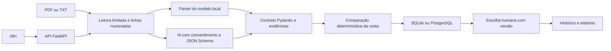

# Arquitetura do Cotera

## Separação de responsabilidades

A interface e a API chamam `service.add_document`. Esse serviço consulta a cesta, lê o documento e verifica se os bytes já foram recebidos antes de chamar a extração. A deduplicação é repetida no banco para proteger inclusões concorrentes.

`documents.py` limita a entrada e define o parser do modelo local. Páginas com texto insuficiente passam por `ocr.py`, que renderiza com pypdfium2 e executa Tesseract local (`por+eng`) via pytesseract com orçamento total de tempo. `extraction.py` usa o mesmo contrato para a saída do provedor. `comparison.py` recebe dados validados e não realiza chamadas externas. A persistência não armazena cálculos fornecidos pelo cliente: cada fotografia recalcula a comparação a partir da cesta e das propostas imutáveis.

## Valores e equivalência

As quantidades têm até três casas decimais; os preços têm até duas. Valores não finitos, negativos ou acima dos limites dos contratos são recusados. Cada linha é arredondada com `ROUND_HALF_UP` antes da soma.

O SKU é a chave de correspondência. Descrições semelhantes não são usadas para unir produtos. Quantidade e unidade precisam coincidir exatamente; não há equivalência implícita entre caixas, unidades ou embalagens.

## Origem dos campos

O documento contém nome, hash dos bytes e texto por linhas. Campos de cabeçalho citam suas linhas em `evidence`; itens citam `source_line`. A validação exige que os valores ocorram na origem indicada, com normalização numérica explícita. Isso reduz valores sem suporte literal, mas não prova a associação semântica entre valor e campo.

O texto nativo e o OCR compartilham a numeração global e a verificação de evidência. `document.pages` registra método, confiança média OCR e intervalo de linhas por página. A confiança não garante acerto de dígitos; `audit.requires_human_review` e `warnings` acompanham a comparação e as exportações. A decisão exige `ocr_reviewed=true` quando houver texto OCR, sem alterar os critérios financeiros de elegibilidade. Documentos antigos sem metadados continuam compatíveis, e o armazenamento mantém o mesmo esquema de tabelas.

Um PDF pode ter suas células extraídas em linhas diferentes. O modo com IA não reúne evidências de várias linhas para um item nesta versão. Nessas situações a extração pode permanecer incompleta e a proposta fica pendente.

## Robustez e observabilidade da IA

`extraction.py` deriva o JSON Schema do contrato Pydantic no modo de serialização, preservando decimais como strings. O pós-processamento exige todos os campos, permite `null` onde o modelo permite e fecha cada objeto com `additionalProperties=false`. Restrições de domínio permanecem no Pydantic local. Um teste compara os campos, tipos e ausências com o antigo esquema manual.

Erros 429/5xx e de timeout/conexão usam espera exponencial com jitter e `Retry-After` (segundos ou data HTTP). `max_attempts`, ou `COTERA_LLM_MAX_ATTEMPTS`, limita cada geração a três tentativas por padrão; o SDK usa `max_retries=0`. Erros permanentes não são repetidos. JSON/Pydantic inválido ou falha em `verify_evidence` permite uma única segunda geração com erros resumidos e o mesmo documento. Recusa ou resposta incompleta encerra a extração sem reparo. A função de espera e o jitter são injetáveis nos testes.

`errors.py` mantém `ProviderError` como base compatível e distingue indisponibilidade transitória, autenticação/permissão, validação, evidência, recusa, resposta incompleta e orçamento. Cada erro possui `code`, mensagem pública em português e `metadata` com uso já observado. Os logs registram somente código e contadores, sem texto documental, resposta ou credenciais. Falhas inesperadas de programação não são convertidas em erros do provedor.

`usage.py` lê tokens de entrada/saída, cache e raciocínio, somando as respostas de todas as tentativas. Cache e raciocínio são subconjuntos dos totais. `extraction` persiste `attempts`, `repair_used`, `elapsed_ms`, `usage`, `usage_complete`, `estimated_cost_usd`, `cost_is_estimate` e `pricing_date`. A interface apresenta as métricas em Documentos; inclusão e consulta pela API também as retornam. Erros HTTP 502 incluem código, mensagem segura e metadados. Reenvios idempotentes devolvem os metadados persistidos.

A tabela compartilhada `cotera/llm_pricing.json` tem data, fontes e tarifas por milhão de tokens; admite preço opcional de cache. `pricing` ou `COTERA_LLM_PRICING_PATH` permite substituí-la. Modelo desconhecido, resposta sem uso ou erro de transporte impede afirmar custo total: a estimativa fica `null`, preservando os tokens conhecidos. Os limites opcionais por documento (`max_tokens`/`max_cost_usd`, também configuráveis por ambiente) reservam cada envio de forma conservadora e interrompem com `BudgetError` antes de exceder a reserva. Não representam uma garantia da cobrança final.

O avaliador usa o mesmo extrator e os mesmos cálculos de consumo/custo. Seu orçamento global reserva cada envio, incluindo retries e reparo; sem uso, mantém a reserva e bloqueia novos envios. O proxy zera o uso por chamada antes de liquidar a reserva para não reutilizar contadores de uma resposta anterior. Relatórios incluem tentativas, correções, cache/raciocínio, uso incompleto e data de preços. Clientes falsos continuam rotulados como simulação; nenhum resultado novo de qualidade com modelo real foi medido.

## Persistência e concorrência

Três tabelas mantêm cestas (`purchases`), propostas (`proposals`) e escolhas (`decisions`). As duas últimas referenciam a cesta; decisões também referenciam a proposta. A restrição única `(purchase_id, document_hash)` evita duplicação por reenvio dos mesmos bytes.

SQLite usa conexões por operação, `foreign_keys=ON`, transação de escrita e fechamento explícito. PostgreSQL usa Psycopg 3, parâmetros posicionais e transação com confirmação ou rollback. A leitura da fotografia usa isolamento repetível no PostgreSQL. A inclusão bloqueia a linha da cesta antes da deduplicação.

Uma nova proposta incrementa a versão. Registrar uma decisão compara a versão exibida com a atual e faz `UPDATE ... WHERE version=expected_version`. Se outra operação mudou o conjunto, a transação não registra a escolha. A interface preserva a versão que a pessoa efetivamente viu antes do envio do formulário.

Decisões são eventos imutáveis. Uma escolha posterior não apaga a anterior. Se novas propostas chegarem depois de uma escolha, a interface informa que o conjunto atual é posterior ao registro.

## Integrações e escopo

O n8n chama apenas o endpoint de inclusão de propostas. Não escolhe fornecedor nem invoca o endpoint de decisão. A extração com IA exige consentimento por chamada e usa `store=False`. Esse parâmetro não substitui a política de tratamento de dados do provedor.

`COTERA_API_KEY` habilita a verificação de `X-Cotera-Key`. É uma credencial por instalação, não um sistema de identidade ou autorização por usuário. O Compose publica portas em `127.0.0.1`.

HTML escapa textos dos documentos. CSV neutraliza prefixos de fórmula. JSON preserva os dados e inclui as linhas extraídas. Documentos e decisões não são enviados por e-mail ou a sistemas de compras.

## Validação

- Testes por domínio: `tests/documents/`, `tests/comparison/`, `tests/persistence/`, `tests/extraction/`, `tests/interfaces/`, `tests/ocr/` e `tests/evaluation/`. A migração preservou os 139 casos coletados, incluindo parametrizações.
- Fixtures em `tests/conftest.py`: documento de referência, SQLite temporário, isolamento de credenciais, bloqueio de clientes/envios reais à OpenAI e verificação dos pré-requisitos de PostgreSQL/OCR. Clientes simulados compartilhados ficam em `tests/fakes.py`.
- Marcadores registrados: `postgres` para o banco de integração, `ocr` para Tesseract real e `slow` para OCR, geração de documentos e fluxos da interface.
- PostgreSQL: teste de integração e serviço configurado no CI; não executado na validação local sem servidor.
- IA: contrato testado com cliente simulado; sem avaliação real de modelo externo.
- n8n: workflow JSON fornecido e conferido estruturalmente; execução depende da instância n8n.

O `pyproject.toml` concentra pytest, Ruff, mypy e cobertura. O Ruff aplica as famílias E/F/I/B/UP/SIM/RUF, alvo Python 3.12 e largura de 120 caracteres; strings documentais longas e caracteres do português são preservados. O mypy verifica os 15 módulos de `cotera/`, com `disallow_untyped_defs`, `check_untyped_defs`, opcionais explícitos e avisos de supressões desnecessárias. Somente as bibliotecas OCR sem stubs têm `ignore_missing_imports`. Dados JSON heterogêneos e respostas dinâmicas do SDK usam `Any` nas fronteiras; contratos Pydantic, documentos, valores monetários, conexões SQLite/PostgreSQL e parâmetros dos serviços têm tipos explícitos. Não há `type: ignore` no pacote. A API declara `response_model=None` nas rotas com retorno JSON para preservar o comportamento e o contrato OpenAPI anteriores às anotações.

A cobertura de `cotera/` inclui ramificações e todos os módulos, inclusive o terminal. A medição local em Python 3.12.16 foi de **90,41%**, com 138 testes aprovados, 1 skip de PostgreSQL e piso de **90,0%**. O job `lint` verifica Ruff e mypy; o job `test` mantém Python 3.12/3.14, PostgreSQL e Tesseract, gera o relatório `term-missing` e publica `coverage.xml` como artefato por versão. Os [comandos locais](../README.md#qualidade-de-código) usam apenas as dependências de desenvolvimento, sem ampliar `requirements.txt`.

[Voltar ao README](../README.md)
