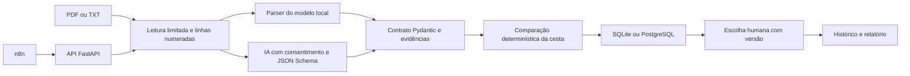

# Arquitetura do Cotera

## Separação de responsabilidades

A interface e a API chamam `service.add_document`. Esse serviço consulta a cesta, lê o documento e verifica se os bytes já foram recebidos antes de chamar a extração. A deduplicação é repetida no banco para proteger inclusões concorrentes.

`documents.py` limita a entrada e define o parser do modelo local. `extraction.py` usa o mesmo contrato para a saída do provedor. `comparison.py` recebe dados validados e não realiza chamadas externas. A persistência não armazena cálculos fornecidos pelo cliente: cada fotografia recalcula a comparação a partir da cesta e das propostas imutáveis.

## Valores e equivalência

As quantidades têm até três casas decimais; os preços têm até duas. Valores não finitos, negativos ou acima dos limites dos contratos são recusados. Cada linha é arredondada com `ROUND_HALF_UP` antes da soma.

O SKU é a chave de correspondência. Descrições semelhantes não são usadas para unir produtos. Quantidade e unidade precisam coincidir exatamente; não há equivalência implícita entre caixas, unidades ou embalagens.

## Origem dos campos

O documento contém nome, hash dos bytes e texto por linhas. Campos de cabeçalho citam suas linhas em `evidence`; itens citam `source_line`. A validação exige que os valores ocorram na origem indicada, com normalização numérica explícita. Isso reduz valores sem suporte literal, mas não prova a associação semântica entre valor e campo.

Um PDF pode ter suas células extraídas em linhas diferentes. O modo com IA não reúne evidências de várias linhas para um item nesta versão. Nessas situações a extração pode permanecer incompleta e a proposta fica pendente.

## Persistência e concorrência

Três tabelas mantêm cestas (`purchases`), propostas (`proposals`) e escolhas (`decisions`). As duas últimas referenciam a cesta; decisões também referenciam a proposta. A restrição única `(purchase_id, document_hash)` evita duplicação por reenvio dos mesmos bytes.

SQLite usa conexões por operação, `foreign_keys=ON`, transação de escrita e fechamento explícito. PostgreSQL usa Psycopg 3, parâmetros posicionais e transação com confirmação ou rollback. A leitura da fotografia usa isolamento repetível no PostgreSQL. A inclusão bloqueia a linha da cesta antes da deduplicação.

Uma nova proposta incrementa a versão. Registrar uma decisão compara a versão exibida com a atual e faz `UPDATE ... WHERE version=expected_version`. Se outra operação mudou o conjunto, a transação não registra a escolha. A interface preserva a versão que a pessoa efetivamente viu antes do envio do formulário.

Decisões são eventos imutáveis. Uma escolha posterior não apaga a anterior. Se novas propostas chegarem depois de uma escolha, a interface informa que o conjunto atual é posterior ao registro.

## Integrações e escopo

O n8n chama apenas o endpoint de inclusão de propostas. Não escolhe fornecedor nem invoca o endpoint de decisão. A extração com IA exige consentimento por chamada e usa `store=False`. Esse parâmetro não substitui a política de tratamento de dados do provedor.

`COTERA_API_KEY` habilita a verificação de `X-Cotera-Key`. É uma credencial por instalação, não um sistema de identidade ou autorização por usuário. O Compose publica portas em `127.0.0.1`.

HTML escapa textos dos documentos. CSV neutraliza prefixos de fórmula. JSON preserva os dados e inclui as linhas extraídas. Documentos e decisões não são enviados por e-mail ou a sistemas de compras.

## Validação

- Testes locais: parser, limites, contratos, evidências, cálculos, armazenamento SQLite, concorrência, API e interface.
- PostgreSQL: teste de integração parametrizado e serviço configurado no CI; não executado na validação local sem servidor.
- IA: contrato testado com cliente simulado; sem avaliação real de modelo externo.
- n8n: workflow JSON fornecido e conferido estruturalmente; execução depende da instância n8n.

[Voltar ao README](../README.md)
